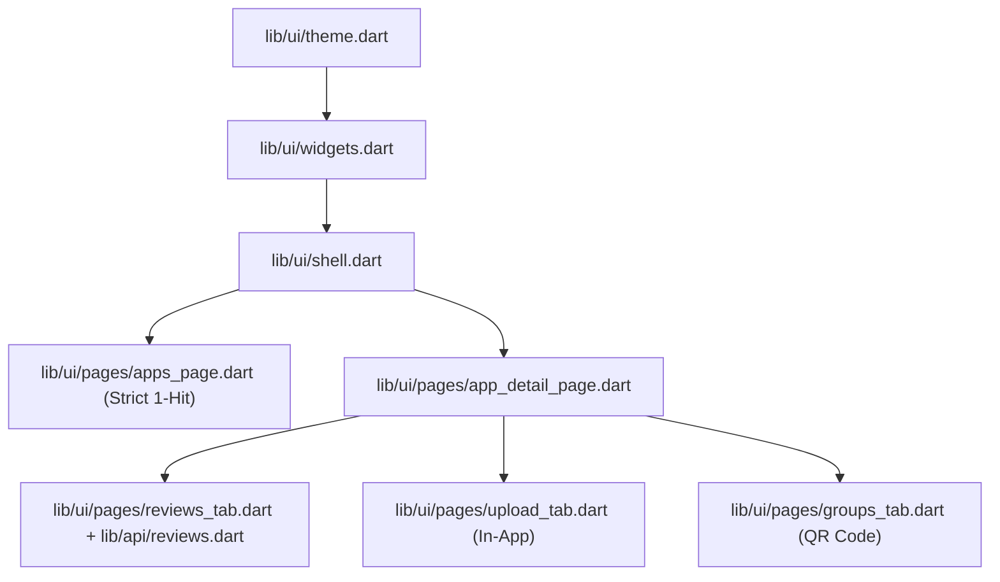

# Handover Instructions: App Store Console UI Redesign & Feature Expansion

## 1. Project Overview & Context
This project is an **App Store Connect Dashboard** built with **Flutter**, designed specifically for **macOS desktop** and the **Web**.
It does **not** use an Apple ID or password; it connects directly via an **App Store Connect API Key** (`Key ID`, `Issuer ID`, and `.p8` private key), stored securely in the **macOS System Keychain** and protected by biometric (Touch ID) / system password auto-lock (`local_auth`, `flutter_secure_storage`).

On desktop, API requests go straight to `https://api.appstoreconnect.apple.com`. On Web, short-lived JWTs are signed in the browser and routed through `server/server.js` (which simply forwards requests to bypass CORS).

### The Objective
Redesign the user interface from a generic Material 3 admin look into an authentic **Apple Human Interface Guidelines (HIG)** desktop application (with matching responsive web layout) supporting both **macOS Light Mode and Dark Mode**, and add critical missing developer features.

---

## 2. Interactive Reference Mockup
A high-fidelity, interactive HTML prototype has been created and saved directly inside the repo:
- **Location**: `mockups/appstore_redesign_mockup.html`
- **To view**: Open this file in Google Chrome, Safari, or Antigravity/Cursor/Windsurf preview.
- **Demonstrated capabilities**:
  - Live Light Mode & Dark Mode toggle button (`☀️ Light Mode` / `🌙 Dark Mode`).
  - macOS Sonoma/Sequoia style unified titlebar with window traffic lights.
  - Streamlined 4-item frosted sidebar.
  - Strict 1-hit Apps catalog with Grid/List layout toggle and status filters.
  - Command Palette (`⌘K` modal).
  - App Detail workspace with in-app **Upload .IPA** tab, **TestFlight QR Code sharing**, and **Customer Review Reply Composer**.

---

## 3. Non-Negotiable User Decisions & Core Rules

### Rule 1: Strict 1-Hit API Guarantee on the Apps Listing Page
- **The Bug in Existing Code**: In `lib/ui/pages/apps_page.dart`, `loadApps()` called `/v1/apps`, then in a loop fired 2 additional HTTP calls per app (`/v1/apps/{id}/appStoreVersions` and `/v1/builds`). For 25 apps, this created **51 network requests** ($1 + 2N$), triggering rate limits and causing slow loading.
- **Strict Requirement**: The listing page MUST make **EXACTLY ONE HTTP request**:
  ```dart
  final page = await client.page('/v1/apps', {
    'limit': '200',
    'sort': 'name',
    'include': 'appStoreVersions',
    'fields[apps]': 'name,bundleId,sku,primaryLocale,appStoreVersions',
    'fields[appStoreVersions]': 'versionString,appStoreState,appVersionState,platform,createdDate',
  });
  ```
- **In-Memory Resolution**: Each app's latest version, platform (`IOS`, `MAC_OS`, `UNIVERSAL`), and state (`READY_FOR_SALE`, `IN_REVIEW`, `PREPARE_FOR_SUBMISSION`) must be resolved directly from `page.inc('appStoreVersions', versionId)` using the existing `ResourcePage` parser in `lib/api/models.dart`.
- **Zero Secondary Calls**: Do NOT query builds, customer reviews, or screenshots on the listing page. Detailed assets are loaded lazily only when entering a specific app's workspace.

### Rule 2: Remove Ratings from the Outside Listing Page
- Do **not** display star ratings or review counts on the outside apps catalog cards.
- Ratings and reviews are housed strictly inside the app's dedicated **Customer Reviews** workspace tab (`_ReviewsTab` / `ReviewsTab`).

### Rule 3: Remove TestFlight from the Outer Storefront Sidebar
- Do **not** have a top-level "TestFlight" tab in the outside sidebar navigation.
- TestFlight beta management (internal/external groups, tester invites, public links, builds) belongs strictly inside each individual app's workspace (`AppDetailPage` -> `TestFlight` tab).

### Rule 4: Remove Pinned Apps Section from Sidebar
- Keep the sidebar minimal and clean.
- The outer navigation destinations in `lib/ui/shell.dart` must have **strictly 4 items**:
  1. **Apps** (`Icons.apps_outlined` / `Icons.apps`)
  2. **Sales & Trends** (`Icons.bar_chart_outlined` / `Icons.bar_chart`)
  3. **Signing** (`Icons.verified_user_outlined` / `Icons.verified_user`)
  4. **Users and Access** (`Icons.group_outlined` / `Icons.group`)

### Rule 5: Upload .IPA Belongs Strictly Inside the App Workspace
- Do **not** place an "Upload .IPA" button on the outside apps catalog.
- An IPA file contains a specific `CFBundleIdentifier` and build version; uploading must take place inside that app's workspace (`AppDetailPage` -> `UploadTab` / `Upload .IPA` tab).
- Provide an "Upload .IPA" quick-action shortcut in the `AppDetailPage` header that jumps to this tab.

### Rule 6: First-Class macOS Dual Theme (Light Mode + Dark Mode)
- **Light Mode Specifications**:
  - Window & Canvas Background: `#F5F6F9` (Apple desktop canvas).
  - Cards & Workspaces: `#FFFFFF` with 1px hairline border `rgba(0, 0, 0, 0.08)` and subtle card shadow.
  - Inset Controls: `#F0F2F5` with active border `#0071E3`.
  - Typography: SF Pro system text with `#1D1D1F` titles and `#6E6E73` secondary labels.
  - Accent Palette: Apple Developer Blue `#0071E3` with soft highlight `#EBF3FF`.
  - Status Badges: Emerald (`#E4F7EA` bg, `#13773B` text) for *Ready for Sale*; Amber (`#FFF4E5` bg, `#9A5B00` text) for *In Review*.
- **Dark Mode Specifications**:
  - Window Canvas: `#111318` deep graphite backdrop.
  - Cards & Workspaces: `#1A1E27` with 1px border `rgba(255, 255, 255, 0.08)`.
  - Inset Controls: `#101217`.
  - Accent: High-contrast vibrant blue `#2997FF`.
  - Status Badges: Tinted translucent pills with glowing indicators.

---

## 4. Missing Features to Implement

### Feature A: Customer Review Reply Composer (`lib/api/reviews.dart` & `lib/ui/pages/reviews_tab.dart`)
- **Background**: The current codebase only *reads* customer reviews. The App Store Connect API supports replying to reviews via `/v1/customerReviewResponses`.
- **Requirements**:
  1. Fetch existing developer response via `GET /v1/customerReviews/{id}/response`.
  2. Post new developer replies via `POST /v1/customerReviewResponses` with payload:
     ```json
     {
       "data": {
         "type": "customerReviewResponses",
         "attributes": { "responseBody": "..." },
         "relationships": {
           "review": { "data": { "type": "customerReviews", "id": "<reviewId>" } }
         }
       }
     }
     ```
  3. Star rating breakdown bars (5★ to 1★) with interactive filters (`All`, `1-3★ Needs Reply`, `Unanswered`).
  4. Quick response templates ("Fix coming soon", "Contact support").
  5. Confirmation dialog before submitting replies to the App Store.

### Feature B: Global Command Palette (`⌘K`)
- In `lib/ui/shell.dart`, add a global keyboard shortcut listener for `Cmd + K` (and `Ctrl + K` on web).
- Opens an Apple Spotlight-style modal search dialog:
  - Instant fuzzy search over all loaded apps (jumps directly into that app's workspace).
  - Quick action commands: "Upload New Build", "Check Sales & Proceeds", "Manage Team", "Lock Console".

### Feature C: TestFlight Public Link QR Code Generator
- In `lib/ui/pages/groups_tab.dart`:
  - When an external beta group has a public link (`https://testflight.apple.com/join/...`), render a QR code widget (or custom painter) directly in the UI.
  - Add a one-click "Copy Link" button with toast notification.

### Feature D: Multi-Locale Clone / Sync Assistant
- In `lib/ui/pages/listing_tab.dart`:
  - Add a "Clone to Other Locales" action.
  - Allows developers to copy "What's New" release notes or promotional text from their primary locale (e.g. `en-US`) to secondary active locales without repetitive copy-pasting.

### Feature E: Data Export (CSV/JSON)
- Add export buttons in `AppDetailPage` and `SalesPage` to export reviews, pricing/IAPs, and sales reports to local `.csv` / `.json` files.

---

## 5. File-by-File Implementation Blueprint



### 1. `lib/ui/theme.dart`
- Refactor `Tokens` to support native macOS Light and Dark palettes:
  - Light: ground `#F5F6F9`, surface `#FFFFFF`, line `#E5E7EB`, ink `#1D1D1F`, muted `#6E6E73`, accent `#0071E3`, accentSoft `#EBF3FF`, accentInk `#0062C4`.
  - Dark: ground `#111318`, surface `#1A1E27`, line `#2B303C`, ink `#F5F5F7`, muted `#9CA3AF`, accent `#2997FF`, accentSoft `rgba(41, 151, 255, 0.16)`, accentInk `#58A6FF`.
- Update `buildTheme(Brightness b)`:
  - Remove generic Material 3 styles.
  - Implement Apple squircle card shapes (`BorderRadius.circular(12)`).
  - Implement custom SegmentedButton and TabBar themes matching macOS System Settings.

### 2. `lib/ui/widgets.dart`
- **`MacTitleBar`**: Custom window header for macOS desktop with traffic lights inset (`EdgeInsets.only(left: 80)` on macOS) and center search trigger (`⌘K`).
- **`StatusBadge`**: Pill widget with live status dot (emerald for `READY_FOR_SALE`, amber for `IN_REVIEW`, rose for `REJECTED`, neutral for `PREPARE_FOR_SUBMISSION`).
- **`AppSquircleIcon`**: High-resolution squircle icon with gradient fallback based on the app's name and platform glyph (e.g. 📱 / 💻).

### 3. `lib/ui/shell.dart`
- Reduce destinations from 5 to **4**:
  ```dart
  const _dests = [
    _Dest('Apps', Icons.apps_outlined, Icons.apps),
    _Dest('Sales & Trends', Icons.bar_chart_outlined, Icons.bar_chart),
    _Dest('Signing', Icons.verified_user_outlined, Icons.verified_user),
    _Dest('Users and Access', Icons.group_outlined, Icons.group),
  ];
  ```
- Implement `_Sidebar`:
  - 240px wide frosted vibrancy sidebar.
  - Dynamic status indicator on the active client card.
  - Lock button at the bottom.
- Implement `CommandPalette`:
  - Listening to `LogicalKeyboardKey.keyK` with `metaPressed` / `controlPressed`.
  - Fuzzy searches loaded apps and triggers navigation.

### 4. `lib/ui/pages/apps_page.dart`
- **Strict 1-Hit Implementation**:
  ```dart
  Future<List<AppSummary>> loadApps(AscClient c) async {
    final page = await c.page('/v1/apps', {
      'limit': '200',
      'sort': 'name',
      'include': 'appStoreVersions',
      'fields[apps]': 'name,bundleId,sku,primaryLocale,appStoreVersions',
      'fields[appStoreVersions]': 'versionString,appStoreState,appVersionState,platform,createdDate',
    });
    return page.data.map((app) {
      final versionIds = app.relIds('appStoreVersions');
      final version = versionIds.isEmpty ? null : page.inc('appStoreVersions', versionIds.first);
      return AppSummary(app: app, version: version);
    }).toList();
  }
  ```
- **UI Elements**:
  - Header: Title "Applications" with "⚡ 1 API Request" badge, Grid/List toggle button.
  - Search field & Status filter pills: `All Apps`, `Ready for Sale`, `In Review`, `Universal & macOS`.
  - App Cards: Display App Icon, Name, Bundle ID, Platform pill, Version (e.g. `v2.4.1`), SKU, and Status Badge. **NO star ratings on outside cards**.

### 5. `lib/ui/pages/app_detail_page.dart`
- **App Hero**:
  - Displays App Icon, Name, Bundle ID, SKU, Apple ID, Active Version, and "View on App Store" link.
  - Quick-action button: `Upload .IPA` (switches directly to `UploadTab`).
- **Segmented Tabs**:
  1. `Store Listing`
  2. `TestFlight & Groups`
  3. `Customer Reviews`
  4. `Builds`
  5. `Upload .IPA`
  6. `In-App Purchases`
  7. `App Review Preflight`

### 6. `lib/api/reviews.dart` & `lib/ui/pages/reviews_tab.dart` (New Feature)
- Create `lib/api/reviews.dart`:
  - `fetchReviewResponse(AscClient client, String reviewId)`
  - `postReviewResponse(AscClient client, String reviewId, String body)`
  - `deleteReviewResponse(AscClient client, String responseId)`
- Create `lib/ui/pages/reviews_tab.dart`:
  - Top rating breakdown card (Average, total count, 5★ to 1★ distribution bars).
  - Rating filter pills (`All`, `1-3★ Needs Reply`, `Unanswered`).
  - Search field.
  - Customer review tiles with date, reviewer nickname, territory, review body, and existing developer replies.
  - Inline response composer with character counter and "Post Reply to App Store" confirmation.

### 7. `lib/ui/pages/groups_tab.dart`
- For external groups with public links:
  - Generate a visual QR Code preview widget.
  - One-click copy invite link to clipboard.

---

## 6. Verification & Testing Guide

### Run Automated Tests
```bash
flutter test test/asc_client_test.dart
flutter test test/submission_test.dart
flutter test test/reviews_test.dart
```

### Manual Verification Checklist
1. **Network Hit Verification**:
   - Inspect network traffic when opening the Apps page: verify that **only 1 request** (`GET /v1/apps?include=appStoreVersions`) is fired. Verify that no background loop fires for `/v1/builds` or `/v1/customerReviews`.
2. **Outside Listing Appearance**:
   - Verify that outside app cards show no star ratings and no build numbers.
   - Verify that there is no "Upload .IPA" button in the outside listing header.
   - Test Grid View and List View toggles.
3. **Sidebar Destinations**:
   - Confirm that the outside sidebar contains strictly 4 items: `Apps`, `Sales & Trends`, `Signing`, `Users and Access`.
   - Confirm there is no outer TestFlight tab and no Pinned Apps section.
4. **App Detail & In-App Uploader**:
   - Click an app card to enter its workspace.
   - Verify that the `Upload .IPA` tab is present inside the app, with target bundle ID displayed.
5. **Customer Reviews & Reply**:
   - Navigate to `Customer Reviews` tab.
   - Verify star rating distribution bars, star filters, and the reply composer.
6. **macOS Light & Dark Appearance**:
   - Toggle theme using the titlebar switch and system appearance.
   - Confirm crisp white cards in Light Mode and deep graphite in Dark Mode.
7. **Command Palette (`⌘K`)**:
   - Press `⌘K` anywhere in the app to verify instant search and app switching.
